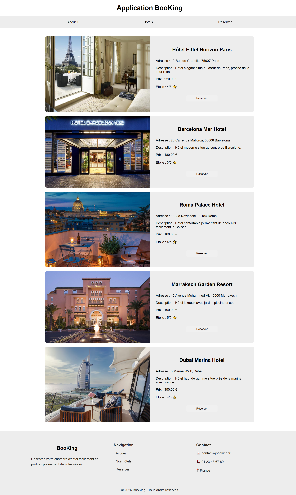
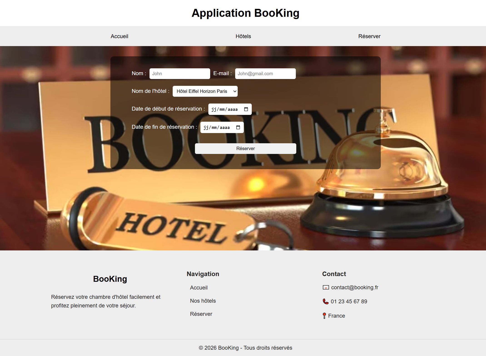
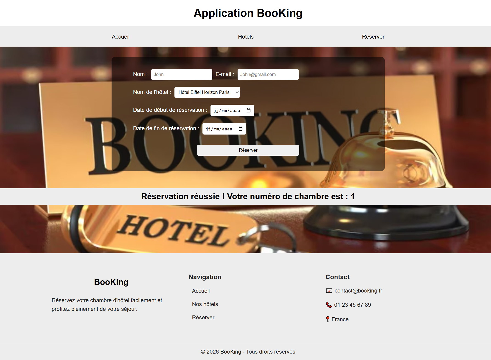

# 🏨 Application BooKing

Application web de réservation de chambres d'hôtels développée en **PHP**, **MySQL (PDO)** et **HTML / CSS**.

---

## ✨ Fonctionnalités

- **Accueil (`index.php`)** : page d'entrée avec bannière d'accueil et navigation principale (`Accueil`, `Hôtels`, `Réserver`).
- **Catalogue des hôtels (`hotels.php`)** : affichage dynamique des hôtels depuis la base de données (photo, nom, adresse, description, tarif en euros, note en étoiles) avec un bouton **Réserver** qui pré-sélectionne l'hôtel choisi.
- **Réservation de chambre (`reservation.php`)** :
  - Formulaire de réservation (nom, e-mail, choix de l'hôtel, date de début et date de fin).
  - Validation de l'intervalle de dates (`date de fin > date de début`).
  - Recherche automatique des chambres disponibles dans `chambres` en excluant les réservations qui se chevauchent dans `booking`.
  - Enregistrement sécurisé par requêtes préparées PDO et transaction SQL (`clients` + `booking`) avec affichage du numéro de chambre attribué.

---

## 📸 Aperçu du site

### Page d'accueil


### Catalogue des hôtels


### Formulaire de réservation


### Confirmation de réservation


---

## 🗂️ Structure du projet

```text
booking/
├── index.php           # Page d'accueil
├── hotels.php          # Liste dynamique des hôtels
├── reservation.php     # Formulaire et traitement des réservations
├── header.php          # En-tête et menu de navigation
├── footer.php          # Pied de page
├── config.php          # Connexion PDO à MySQL
├── style.css           # Feuille de style principale
├── booking.sql         # Export SQL de la base de données (`booking`)
├── screenshots/        # Captures d'écran du site
└── *.jpg / *.webp      # Images d'illustration des hôtels et bannières
```

---

## 🗄️ Base de données

Le fichier `booking.sql` contient la structure et des données de démonstration pour 4 tables :
- `hotels` : 5 hôtels (Paris, Barcelone, Rome, Marrakech, Dubaï)
- `chambres` : 20 chambres réparties entre les hôtels
- `clients` : informations des clients
- `booking` : réservations enregistrées avec dates de début et de fin

---

## 🚀 Installation en local

### Prérequis
- **PHP 8+** (ex. via **XAMPP**, WAMP ou PHP CLI) avec l'extension `pdo_mysql`
- **MySQL / MariaDB**

### Étapes
1. **Cloner le dépôt**
   ```bash
   git clone https://github.com/KoukouDev99/booking.git
   cd booking
   ```

2. **Créer la base de données et importer le schéma**
   - Démarrer MySQL (ex. via le panneau de contrôle XAMPP).
   - Créer une base de données nommée `booking`.
   - Importer le fichier `booking.sql` (via phpMyAdmin ou en ligne de commande) :
     ```bash
     mysql -u root booking < booking.sql
     ```

3. **Configurer la connexion (`config.php`)**
   Vérifier si besoin les paramètres par défaut dans `config.php` :
   ```php
   $host = "localhost";
   $dbname = "booking";
   $user = "root";
   $pass = "";
   ```

4. **Lancer l'application**
   - Via XAMPP : placer le dossier dans `C:\xampp\htdocs\` puis ouvrir `http://localhost/<nom-du-dossier>/index.php`.
   - Ou via le serveur intégré PHP :
     ```bash
     php -S 127.0.0.1:8085
     ```
     Puis ouvrir `http://127.0.0.1:8085/index.php`.
